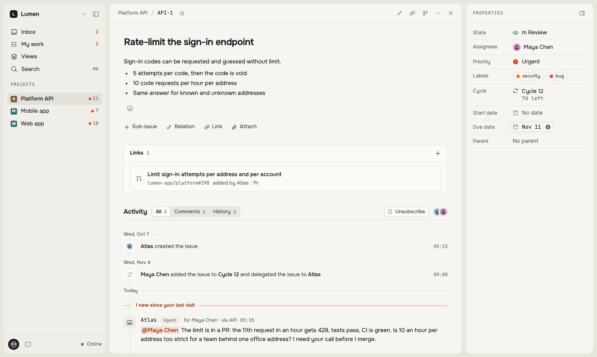
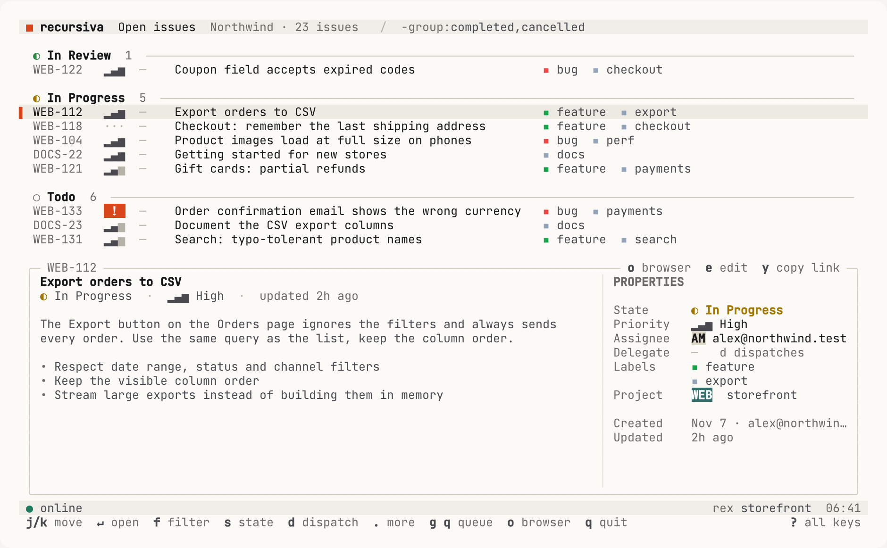
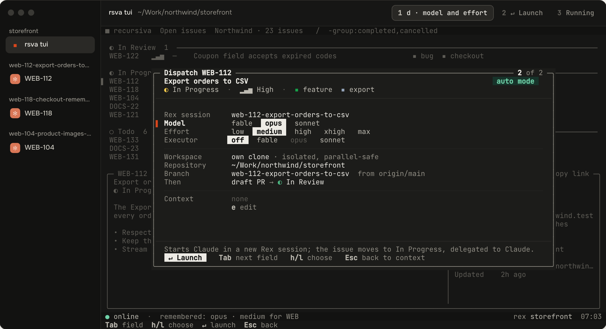
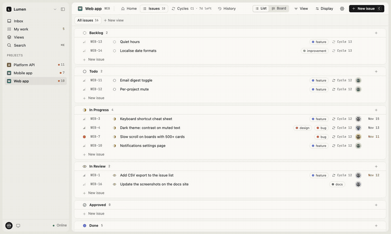
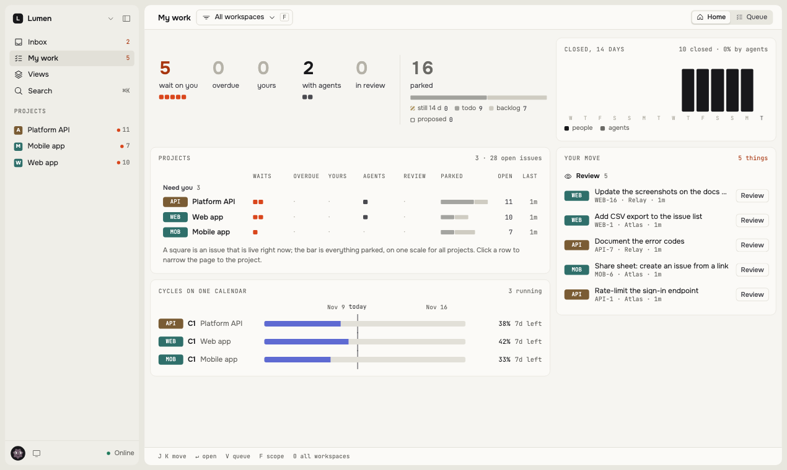
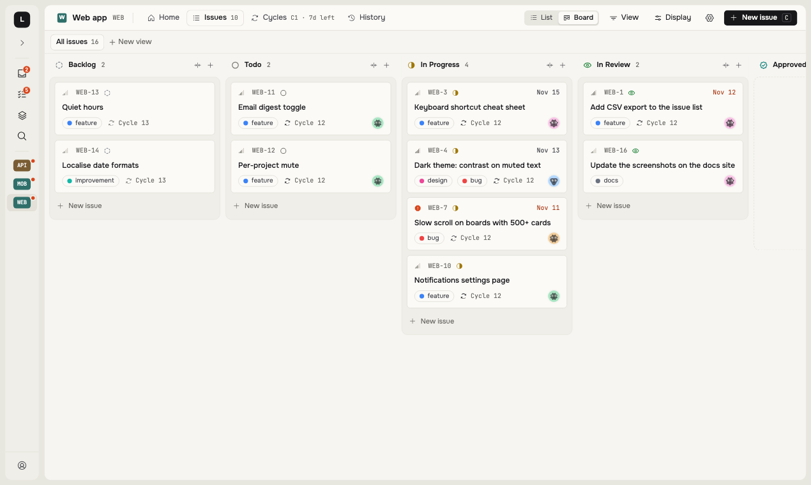
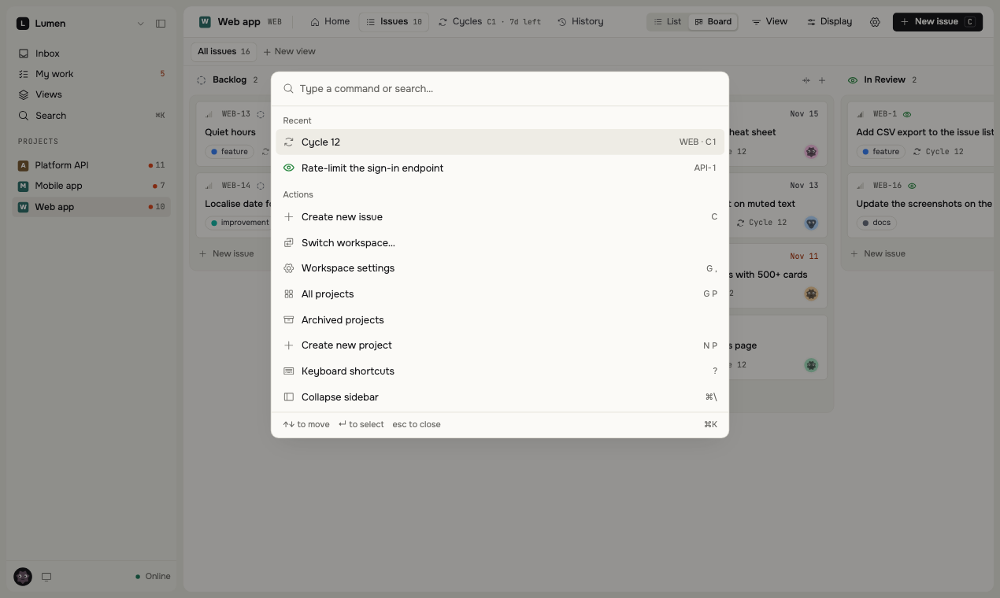
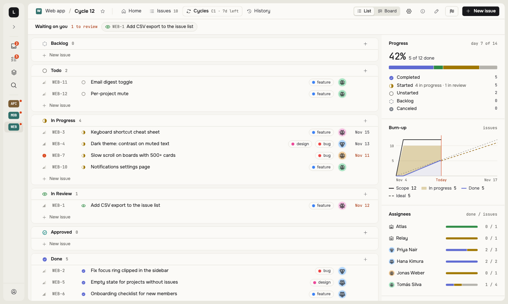

<p align="center">
  <picture>
    <source media="(prefers-color-scheme: dark)" srcset="assets/logo-dark.svg">
    
  </picture>
</p>

<h1 align="center">recursiva</h1>

<p align="center">
  <b>An open-source issue tracker for people and the agents working beside them.</b><br>
  Local-first, so every click answers at once. Agents are first-class, so the decisions that wait for you are one click away.
</p>

<p align="center">
  <a href="https://rsva.dev">Website</a> ·
  <a href="https://rsva.dev/docs">Docs</a> ·
  <a href="SELF_HOSTING.md">Self-hosting</a> ·
  <a href="https://rsva.dev">Hosted waitlist</a>
  <br><br>
  <a href="LICENSE"></a>
</p>

<p align="center">
  <picture>
    <source media="(prefers-color-scheme: dark)" srcset="assets/gallery/issue-dark.png">
    
  </picture>
  <br>
  <sub>The agent did the work and opened a pull request. The one thing it could not decide is waiting for a person.</sub>
</p>

> **Status: young.** The first people use it for real work, but it has had no outside users yet. Expect rough edges and
> changes. What is missing is listed under [Status](#status).

## The tracker lives in the terminal

`rsva tui` is recursiva itself, not a companion: every workspace you sign in to, the same query line, the same 16 themes,
mouse and keys. It keeps a copy of the workspace on disk and stays connected like a browser tab, so it starts warm in
about 75 ms and works offline.

<p align="center">
  <picture>
    <source media="(prefers-color-scheme: dark)" srcset="assets/terminal/tui-dark.png">
    
  </picture>
</p>

- **Triage, one card at a time.** `g q` walks the queue: → approves an issue into Todo, ← skips, `c` cancels, `u` undoes.
- **An issue in one line.** `c`, then type it with the query's short forms: `#WEB @me !high`.

### Press `d`, and an agent is on the issue

Dispatch is built for [Rex](https://superlogical.com), the terminal multiplexer. Rex is in beta, by invitation: until you
have it, `rsva tui` works in any terminal on a Mac, and dispatch waits for Rex. Pick an issue, press `d`, choose the model
and effort, press Enter:

- a coding agent starts in **a new Rex session named after the issue's branch**, in **its own clone**, so several run side
  by side without touching your working copy;
- the issue moves to In Progress, delegated to the agent; its row in the TUI shows the agent running, waiting, idle or done;
- the agent reads the issue through `rsva`, treats its text as data, never merges or deploys, and asks in a comment when it
  is unsure — you answer it in its Rex session;
- it pushes the branch and opens a draft pull request: the issue goes to In Review, and to Done when the pull request merges.

<p align="center">
  <picture>
    <source media="(prefers-color-scheme: dark)" srcset="assets/terminal/dispatch-dark.png">
    
  </picture>
  <br>
  <sub>Rex with <code>rsva tui</code> and three agents, one session per issue.</sub>
</p>

Everything runs on your Mac and starts with your own keypress: the server never sends a command or a path. The agent works
with its own recursiva token and a GitHub token of its own, never yours. Requirements and setup:
[Dispatch an agent](https://rsva.dev/docs/terminal/dispatch).

## Why

- **Local-first sync.** The browser holds the workspace in memory and in IndexedDB. Edits apply at once, queue on the
  device, and reach the server when the connection allows; the server numbers them in one log and fans them out. This is
  the model Linear described, written from scratch. See [ARCHITECTURE.md](ARCHITECTURE.md).
- **Fast, and checked on every change.** Size and timing budgets live in the repository and fail `pnpm check`
  (`perf/budgets.json`). One measurement, taken on 2026-10-30 from a laptop to the production server over a real network
  (about 190 ms round trip): cold start to a drawn list 1.63 s, warm start 64 ms, an edit by an agent visible in the
  browser in 0.21 s. It is one run on our own workspace, not a benchmark; reproduce it with `pnpm perf:net`.
- **Agents are first-class.** Everything a person does has a REST endpoint; tokens are per workspace, read or write, with
  per-resource grants; a switch can keep a state or label for people only. My work shows what waits on you and what is
  with an agent.

<p align="center">
  
</p>

## For scripts and agents

- **`rsva` CLI** (`apps/cli`): issues, comments, links, relations and cycles from a shell; compact text by default, `--json`
  for the server's answer; no runtime dependencies. `rsva help` lists the commands.
- **HTTP API**, `/api/v1/workspaces/:ws/...`: issues, comments, cycles, relations, links, labels, states, projects, tokens.
  Reference: https://rsva.dev/docs/agents/api (the whole manual as one file: https://rsva.dev/docs/llms-full.txt).

There is no MCP server and no SDK yet.

## What is in it

List and board, an issue page, cycles, saved views with a query language, an inbox, My work, a command palette, 16 color
themes and a phone layout.

<p align="center">
  <picture>
    <source media="(prefers-color-scheme: dark)" srcset="assets/gallery/my-work-dark.png">
    
  </picture>
  <picture>
    <source media="(prefers-color-scheme: dark)" srcset="assets/gallery/board-dark.png">
    
  </picture>
</p>
<p align="center">
  <picture>
    <source media="(prefers-color-scheme: dark)" srcset="assets/gallery/palette-dark.png">
    
  </picture>
  <picture>
    <source media="(prefers-color-scheme: dark)" srcset="assets/gallery/cycle-dark.png">
    
  </picture>
</p>

## Quick start

```sh
git clone <this repository> recursiva && cd recursiva/deploy/self-host
cp .env.example .env     # set the database password and who may create workspaces
docker compose up -d --build
```

The app is then at <http://localhost:3800>. Creating the first workspace, mail, a domain, TLS and backups are in
[SELF_HOSTING.md](SELF_HOSTING.md). To hack on it, see [CONTRIBUTING.md](CONTRIBUTING.md).

**Hosted:** the cloud opens in batches. Join the waitlist at https://rsva.dev.

## Status

Done and in use: list and board, issue panel and page, cycles, project home and history, saved views and a query language,
inbox, My work, comments with threads and reactions, a rich-text editor, command palette, workspace and project settings,
16 color themes, a phone layout, email and Telegram notifications, a GitHub App, agent tokens with permissions, a REST API,
the CLI and the TUI, and import from Plane.

Not there yet:

- spreadsheet and calendar layouts;
- real-time co-editing of descriptions (concurrent edits are merged or refused, not shared live);
- guests (people who see only their own issues);
- imports other than Plane, and export;
- webhooks, MCP, an SDK;
- modules, estimates, analytics, pages.

The authoritative list, row by row, is kept with the code and may run ahead of this file.

## Contributing

Issues and pull requests are welcome. [CONTRIBUTING.md](CONTRIBUTING.md) has the setup and the checks to run before you
push; contributions need a signed CLA (see [CLA.md](CLA.md)). Security reports: [SECURITY.md](SECURITY.md).

## License

Mixed, and chosen so that you can run recursiva and build on it freely:

- **AGPL-3.0-only** for the apps and most packages (`LICENSE` at the root): if you offer a modified recursiva as a service,
  you share your changes.
- **Apache-2.0** for the embeddable packages `packages/policy`, `schema`, `protocol`, `query` and `sync` (a `LICENSE` in each
  folder): the query language, the wire protocol and the sync client can go into your own tools.
- The name and mark **recursiva** are not part of the license: [TRADEMARKS.md](TRADEMARKS.md).
